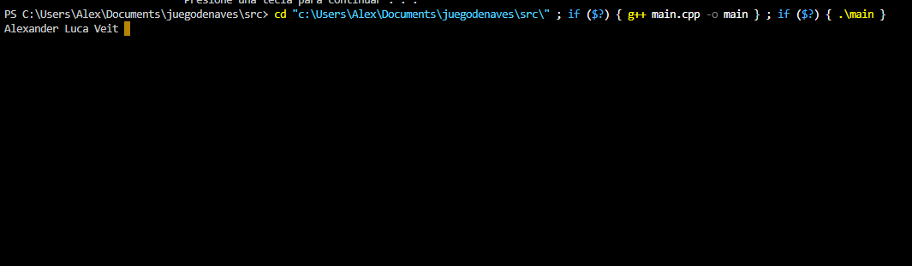

# Juego de Naves

Minijuego de consola implementado en C++ con programación orientada a objetos (actividad 8 de Laboratorio de Programación). La nave del jugador debe destruir asteroides que caen desde arriba, disparando con la barra espaciadora, sin perder las tres vidas iniciales.

## Características

- Motor de juego basado en un bucle `while (!gameOver)` con dibujo por coordenadas (`gotoxy`).
- Tres clases: `Nave` (jugador), `Asteroide` (obstáculos) y `Bala` (disparos).
- HUD en pantalla con nombre del piloto, vidas y puntaje (+10 por asteroide destruido).
- Cinco asteroides en simultáneo, que reaparecen arriba en posiciones aleatorias.
- Detección de teclado sin esperar a Enter mediante `_kbhit()` / `_getch()`.



## Controles

| Tecla | Acción |
| --- | --- |
| `A` / `D` | Mover a la izquierda / derecha |
| `W` / `S` | Mover arriba / abajo |
| `Espacio` | Disparar |

Las mayúsculas funcionan igual que las minúsculas.

## Requisitos y compilación

Requiere **Windows** (usa `windows.h`, `conio.h`, `Sleep` y `system("cls")`) y una consola de al menos 80×25 caracteres.

```powershell
g++ -std=c++11 -Wall -O2 src/main.cpp -o juego.exe
.\juego.exe
```

También compila con Visual Studio: `cl /EHsc src\main.cpp`.

## Estructura

```
src/main.cpp                  Código completo del juego
src/funcionalidades/          Pista del ejercicio de puntaje (no se compila)
docs/manuales/                Manual del usuario, manual del programador y changelog
docs/Informe...v1.0.0.pdf     Informe de la actividad
capturas/                     Capturas de partidas
```

## Documentación

- [Manual del usuario](docs/manuales/manual_usuario.md)
- [Manual del programador](docs/manuales/manual_programador.md)
- [Informe de la actividad (PDF)](docs/InformeEEST1_LPR2026_ACT08_AlexanderVeit_Informe_v1.0.0.pdf)

## Autor y licencia

Alexander Veit — E.E.S.T. N°1 de Vicente López, Laboratorio de Programación 5°3.  
Distribuido bajo licencia MIT; ver [LICENSE](LICENSE).
